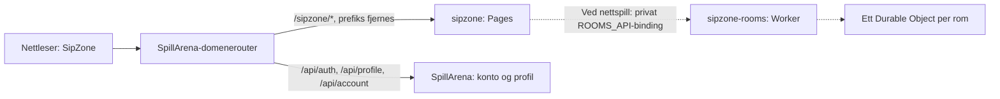

# SipZone – forslag til oppsett

Opprinnelig plan og visuell retning fra 18. oktober 2026. MVP-en er nå
implementert; se [README](../README.md) for faktisk oppsett og [TODO](../TODO.md)
for alle lekene. Resten av dokumentet bevarer den opprinnelige gjennomgangen
og forslagene. Cloudflare-kontoen og den eksterne domenerouteren er ikke endret.

## Anbefalt utgangspunkt

Bruk **Hitline som teknisk mal**, **SpillArena som kilde for felles konto og
samtykke**, og en egen visuell identitet bygget rundt et norsk vorsbord.
SipZone blir én samling leker under `/sipzone/`, med en felles spillerliste og
et eget spillområde for hver lek.

Første utgave bør prioritere at alle sitter rundt én mobil eller skjerm.
Nettrom kan legges til for leker som faktisk trenger hver sin enhet. Utvalget
du kommer med avgjør hvilke spillmoduser og hvilken backend vi trenger.

## Hva de andre prosjektene gjør

| Område | Funn i repoene | Forslag for SipZone |
| --- | --- | --- |
| Frontend | Nyere prosjekter bruker React 19, TypeScript 6 og Vite 8. HangBot bruker JavaScript og Vite 7. | Følg de nyere TypeScript-prosjektene. |
| Styling | Huben, PixelPanic og ProportionPanic har Tailwind 4. Hitline og MelodyRush bruker i hovedsak egen CSS. | Egen CSS med variabler, som Hitline. Bruk samme navigasjonsramme. |
| UI | `SiteShell`, `arena.css`, innstillinger og footer går igjen. Hubens ramme har maksvidde 1760 px, 36 px sidemarg og 86 px header på store skjermer. | Gjenbruk rammen og mobiltilpasningene. Tilpass farger, typografi og spillflater. |
| Konto | Hubens `src/account/` er den dokumenterte hovedkopien. Koden kopieres inn i spillene. | Bruk samme klient, kontomerke og samtykkeflyt. Huben fortsetter å eie kontoene. |
| Språk og tema | Norsk/engelsk og lys/mørk visning. Huben bruker i18next, Hitline en liten React-provider. Hitline støtter også systemtema. | Norsk innhold først. Gjør UI-tekst oversettbar og bruk samme tema- og språkvalg som huben. |
| Hosting | Separate Cloudflare Pages-prosjekter, produksjonsbygg i `dist/`. Spillene vises under stier på SpillArena-domenet. | Pages-prosjekt `sipzone`, med Vite-base `/sipzone/`. |
| Nettspill | Hitline og MelodyRush har separate rom-Workers og Durable Objects. | Samme modell dersom de valgte lekene trenger nettrom. |
| Database | Flere ledertavler deler D1-databasen `spillarena-hub`. Migrasjonene eies av SpillArena-repoet. | Bruk hubens profil-API ved et konkret behov. Vurder datalagring etter at lekene er valgt. |
| Verifikasjon | Vite-bygg og TypeScript er felles. Flere prosjekter har ESLint. Hitline/MelodyRush tester regler og rom med Nodes testkjører. | Samme byggeflyt; test spillregler og lagring når de implementeres. |

Versjonene over er observert i `package.json` i disse repoene. Eksakte versjoner
og lockfil fastsettes ved opprettelse av appen; de er ikke en påstand om hvilke
versjoner som er nyest på npm.

Konkrete referanser for implementeringen:

- `Hitline/src/ui/SiteShell.tsx`, `arena.css` og `SettingsMenu.tsx`: navigasjon,
  innstillinger og footer.
- `SpillArena/src/account/`: felles konto, lokal lagring og samtykke.
- `Hitline/vite.config.ts`: base path og lokal proxy til hubens API.
- `Hitline/wrangler.jsonc`: Pages og privat servicebinding til romserver.
- `Hitline/shared/game.ts`: spillregler delt mellom nettleser og server.
- `SpillArena/shared/games-registry.js`: tillatte profilnavn.
- `SpillArena/migrations/`: eierskap til felles databaseskjema.

## Visuell retning: et norsk vorsbord

Siden skal føles som å sette seg ved et bord der kortstokken allerede ligger
fremme. SpillArena-navigasjonen gir gjenkjennelse, mens innholdet har sin egen
personlighet. [Den visuelle skissen](design/index.html) konkretiserer retningen.

| Del | Retning |
| --- | --- |
| Bakgrunn | Dyp flaskegrønn, `#153a30`, med svak bord-/papirtekstur. |
| Spillkort og tekst | Varm krem, `#f6f0dc`, med tydelig mørk skrift. |
| Hovedhandlinger | Oransje, `#ff825b`, med mørk tekst. |
| Små detaljer | Smørgul `#eadc90`, korallrød og dempet grønn. |
| Typografi | Kraftige, litt trange overskrifter; ryddig sans-serif i kontroller og spilltekst. Vurder Archivo fra Hitline, lokalt hostet. |
| Form | Avrundede kort, trykte rammer, brikker, små stempler og litt skjeve dekorasjoner. Interaktive flater står rett og er enkle å treffe. |
| Motiver | Kortfarger, flaskekork, ølglass, glassbrikker og en generisk snusboks. Samme illustrasjonsstil på alle motivene. |
| Bevegelse | Et kort som snus, en bunke som deles ut, et stempel når noe velges. Korte overganger, støtte for redusert bevegelse. |

Snusboksen og drikken er rekvisitter som gir norsk vorspreg. Detaljene ligger
langs kanten av spillområdet, slik at selve teksten og neste handling får
plassen de trenger. Illustrasjonene kan lages i SVG/CSS, slik flere av
SpillArena-plakatene allerede gjøres.

Lys visning bruker krem som hovedbakgrunn, grønne kortbaksider og de samme
oransje handlingene. Lagrede temaønsker fra SpillArena skal respekteres.

## Sideoppsett og flyt

### Forside

1. **Felles header:** SipZone-logo til venstre. Tilbake til SpillArena,
   kontomerke og innstillinger til høyre, med samme rekkefølge som Hitline.
2. **Kort introduksjon:** «Gode venner. Dårlige unnskyldninger.» og én setning
   om hva man gjør. Ved siden av ligger et illustrert bord med kort og rekvisitter.
3. **Velg lek:** Spillkort med navn, én setning, antall spillere, cirka spilletid
   og eventuelt nødvendig utstyr. Bruk bare opplysninger som passer den faktiske
   leken. Kategorier og filtre bestemmes av spillutvalget.
4. **Slik kommer dere i gang:** Velg lek → legg til gjengen ved behov → spill.
5. **Felles footer:** SpillArena-tilhørighet, GitHub og lagringsvalg.

Forsiden skal raskt føre til lekene. Et lite utvalg trenger hverken søk eller
mange filtre. I skissen er mulige innholdstyper tydelig merket som forslag;
ingen spill er annonsert eller gjort spillbare.

### Oppsett av en lek

Velg lek → kort regelvisning → spillerliste og lekens egne valg → start.
Noen leker trenger hverken navn eller et eget oppsettssteg; de skal kunne
starte direkte. Antall spillere og eventuelle begrensninger kommer fra leken.

Spillerlisten kan følge med når gjengen bytter lek. Brukeren velger selv om
den skal huskes på enheten; standarden er at navnene bare lever under besøket.
Lokalt spill kan bruke kallenavn uten konto, tilsvarende festmodusen i Hitline.

### Under spilling

- Et stort kort eller et tydelig bord som viser én hovedoppgave om gangen.
- En synlig primærhandling, for eksempel «Neste kort», valgt etter leken.
- Hopp over, regler og avslutt er enkle å finne. Tilbake skal ikke slette
  en pågående runde uten at brukeren får beskjed.
- Spillernavn og turmarkør vises når leken har turer.
- På mobil ligger hovedhandlingen lett tilgjengelig med én hånd, med plass
  til nettleserfelt og skjermens safe areas.
- Ved rundeslutt: «En runde til» og «Velg en annen lek», med samme gjeng.

Store treffområder på minst 44 px, tydelig tastaturfokus og lesbar kontrast
gjelder også i den lekne utformingen. Regler og dialoger trenger fokusstyring
og tastaturbetjening. Lyd, vibrasjon og automatisk avspilling vurderes først
hvis en lek har nytte av det.

## Foreslått kodestruktur

Strukturen under er et mål for implementeringen, ikke mapper som allerede er
opprettet. `functions/` og `workers/rooms/` kommer først ved behov for backend.

```text
src/
  main.tsx
  App.tsx                   # Knytter sammen visninger og gjeldende økt
  account/                  # Kopi fra huben, holdes i takt med hovedkopien
  ui/                       # SiteShell, innstillinger, dialog, logo
  features/
    home/                   # Forside og valg av lek
    party/                  # Spillerliste og felles oppsett
    play/                   # Felles spillramme og rundeslutt
  games/
    registry.ts             # Metadata og innlasting av tilgjengelige leker
    <lek>/                  # Lekens egne React-komponenter og styling
  i18n/
    no.ts
    en.ts                   # Legges til når innholdet oversettes
  lib/                      # Lagring via SpillArena-samtykke
  styles/
    tokens.css
    base.css
    sipzone.css
shared/
  party.ts                  # Delte typer for spillerliste og økt
  games/<lek>/              # Regler og innhold uten React-avhengighet
public/
  favicon.svg
  _headers
  _redirects
tests/                      # Regler, økter og lagring
vite.config.ts
wrangler.jsonc
```

En liten katalog beskriver hver lek med ID, navn, beskrivelse, spillerantall,
eventuelt varighet/utstyr og hvilke moduser den støtter. Hver lek eier sine
egne regler og sin egen tilstand. Felles kode tar hånd om spillerlisten,
navigasjon, samtykke og den visuelle rammen. Katalogen kan laste lekene ved
behov hvis størrelsen gjør det nyttig.

Dette gir plass til både kortleker og helt andre mekanikker uten at alle må
presses inn i samme kortmotor. React-state er et passende utgangspunkt for
første utgave. Behov for større tilstandsbibliotek vurderes ut fra lekene.

## SpillArena-konto, språk og lagring

Gjenbruk kontokoden fra **hubens** `src/account/`, siden den er dokumentert som
hovedkopi. Hitline er referansen for hvordan kontomerket settes inn i skallet.
Unngå å kopiere Hitlines musikkinnhold, profilmodell eller romlogikk inn som
del av SipZones grunnoppsett.

Kontokall går til `/api/auth`, `/api/profile` og `/api/account` på huben.
De skal være absolutte fra domenets rot, også når appen ligger under
`/sipzone/`. Felles innlogging forutsetter samme origin; en egen
`*.pages.dev`-adresse deler ikke nettleserlagring med `spillarena.no`.

Behold nøklene `spillarena.session` og `cookie-consent`. Bruk eksisterende
`consentStorage` for innstillinger og eventuell fremgang. Etter avslag beholdes
slike data i minnet under besøket; selve samtykkevalget huskes fortsatt.
Samtykketeksten må beskrive det SipZone faktisk lagrer. XP, rekorder og
ledertavler er valg som avhenger av lekene, og skal ikke loves på forhånd.

Den faktiske koden i både hubens `src/i18n/i18n.ts` og Hitline bruker `lang`
for språkvalget, selv om hubens README fortsatt omtaler `language`. Følg koden:
del `lang` og `theme` med huben. Bruk `no` internt der felleskoden forventer
det, og `nb` som norsk dokumentlang.

Hvis SipZone får personlige profiler, må `sipzone` legges til i hubens
`shared/games-registry.js` og den delte `GameId`-typen. En spillerliste på én
felles enhet representerer en hel gjeng; resultater fra den økten skal ikke
automatisk behandles som den innloggede personens prestasjon.

## Cloudflare-oppsett

Følg Pages-oppsettet i Hitline: Vite-base `/sipzone/`, byggekommando
`npm run build`, publiseringsmappe `dist/` og en versjonert `wrangler.jsonc`.
Dette samsvarer med [Cloudflares dokumentasjon for Pages-konfigurasjon](https://developers.cloudflare.com/pages/functions/wrangler-configuration/).

Domenerouteren må sende `/sipzone` og `/sipzone/*` til SipZones Pages-prosjekt
og fjerne prefikset ved videresending, slik de andre spillenes README-er
beskriver. Routerkoden er ikke funnet i de undersøkte repoene; faktisk
konfigurasjon må bekreftes før integrasjon. `/api/*` for konto skal fortsatt
gå til huben.

Bruk samme mønster for `_headers` og prefiksomskrivinger i `_redirects` som
Hitline. Test både direkte innlasting og oppfriskning av understier. For
forhåndsvisning direkte på Pages kan appen bygges med `VITE_BASE_PATH=/`, som
Hitline allerede støtter. Cloudflare beskriver [SPA-ruting her](https://developers.cloudflare.com/pages/configuration/serving-pages/).

Ved nettrom følger vi Hitlines oppdeling:



Nettrom trenger serverstyrte turer, regler og skjult informasjon, samt
gjenoppkobling og utløp. Bruk eksisterende konto- og rompraksis som utgangspunkt,
men bestem spillerkrav, transport og synkronisering ut fra de faktiske lekene.
Det er ingen grunn til å opprette romserveren for leker som bare bruker én skjerm.

Det lokale grunnoppsettet bør bruke Node 24 og kommandoene `dev`, `build`,
`preview`, `lint` og `test`. Konto-proxy går til huben på port 8789. Dersom
romserveren innføres, bruker den port 8788 som i Hitline. Ingen hemmeligheter
legges i klientvariabler eller Git.

Når SipZone får en binding til felles D1, eies eventuelle skjemaendringer av
SpillArena-repoet. Bindingsnavn, databaser og hemmeligheter skal knyttes til
et konkret behov; første lokale spill trenger ikke egen database.

## Rekkefølge videre

1. Opprett React/TypeScript/Vite-grunnlaget og lås avhengighetene. Gjenbruk
   navigasjon, konto og samtykke fra kildene over.
2. Bygg forside, lys/mørk visning og felles spillerliste i den foreslåtte stilen.
3. Når lekene er valgt: definer metadata, regler, nødvendig utstyr og moduser
   for hver lek. Implementer én komplett lek og bruk den til å avklare hva
   resten av lekene faktisk kan dele.
4. Legg til flere leker. Innfør nettrom eller lagret fremgang der det trengs.
5. Kontroller mobil, tastatur, tema, lagringsvalg og bygg. Test spillreglene,
   spillerbytte og eventuell servervalidering.
6. Integrer i hubens spilloversikt med illustrasjon og tekst. Oppdater profil-
   register ved profilbehov, og avklar routeren før publisering under `/sipzone/`.

Neste innspill er spillutvalget. Denne planen gir plass til det uten å bestemme
spillregler, spillergrenser eller kategorier på forhånd.
